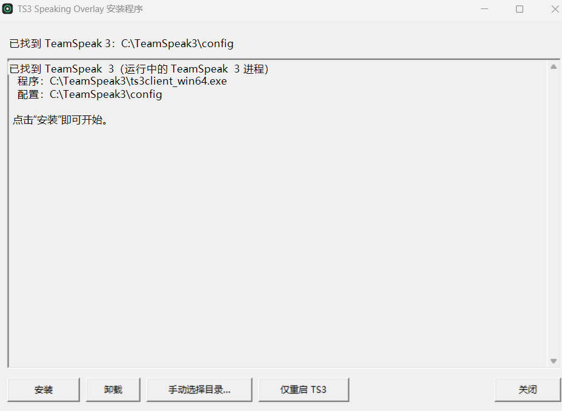
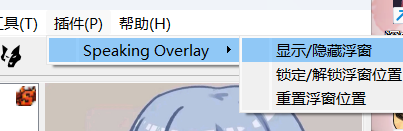
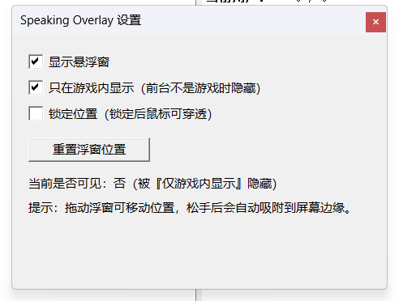

# TS3 Speaking Overlay

**English** | [简体中文](README.md)

A TeamSpeak 3 client plugin that shows **everyone in your current channel** in a
floating, always-on-top overlay — the way KOOK does it. Whoever is talking is
highlighted with a pulsing green ring; everyone else stays in place but is
**dimmed**, so the panel never blinks in and out of existence. The overlay has a
**transparent background** with just a rounded frame around it.


## Features

- **Always on top**: `WS_EX_TOPMOST | WS_EX_LAYERED`, so it shows over games in
  borderless/fullscreen-windowed mode, browsers and players.
- **Transparent background**: only a rounded frame is drawn (dark halo + white
  stroke), the game shows through completely; nicknames get a 1 px black shadow so
  they stay readable on bright scenes.
- **The whole channel**: members come from `getChannelClientList`. Speakers are
  highlighted with a pulsing green ring, the rest are **dimmed but keep their
  slot** (KOOK behaviour) — icons do not vanish when nobody talks.
- **Avatars + nicknames**: fetched through `ts3Functions.getAvatar()` and clipped
  to a circle; clients without an avatar fall back to a coloured initial disc.
- **Colour emoji in nicknames**: nicknames are drawn with Direct2D + DirectWrite
  (`D2D1_DRAW_TEXT_OPTIONS_ENABLE_COLOR_FONT`), so 😂🎮👍❤️ render properly. GDI+
  has no font fallback at all and draws them as empty boxes.
- **Talking ring**: a green pulsing ring on the current speaker; multiple
  simultaneous speakers are ordered by `clientID`, so rows never shuffle.
- **Only while gaming** (can be turned off): checks whether the foreground window
  is a game. On the desktop, in a browser or in a chat app the overlay does not
  appear at all — same as KOOK.
- **Snaps to screen edges**: release the drag within 36 px of an edge and it
  aligns itself.
- **Hides only when the channel is empty**: nobody connected / empty channel →
  `SW_HIDE`; as long as members exist the panel stays, just dimmed.
- **Draggable / lockable**: drag with the left button while unlocked, position is
  persisted to `overlay.ini`; when locked it becomes fully click-through
  (`WS_EX_TRANSPARENT`) and clicks reach the game underneath.
- **No taskbar button, no focus stealing**: `WS_EX_TOOLWINDOW | WS_EX_NOACTIVATE`.
- **No server-side permissions needed**: it is a pure client plugin, nothing has
  to be installed on the server.
- **Both bitnesses ship**: 64-bit clients (3.6.x) need API 26, 32-bit clients
  (≤3.5.x) need API 25. The installer picks the right one automatically.

## One-click install (recommended)

Download `TS3SpeakingOverlay-Setup.exe` from the
[latest release](https://github.com/EMIRIA2333/TS3SpeakingOverlay/releases/latest)
and run it. It is a **single file with both plugin DLLs embedded** and needs **no
runtime redistributable** (statically linked with MinGW; the only runtime import
is the system's own `msvcrt.dll`).



- Finds TeamSpeak 3 automatically, trying in this order: **running TS3 process →
  registry `HKCU\Software\TeamSpeak 3 Client` → the usual folders on every fixed
  drive (`teamspeak`, `TeamSpeak3`, `ts3`, `Program Files\TeamSpeak 3 Client`, …)
  → a depth-limited scan of each drive root (2 levels)**. Both portable installs
  (config in `<TS3>\config`) and standard installs (config in
  `%APPDATA%\TS3Client`) are supported.
- **Detects the client bitness** by reading the PE header of the client exe and
  installs `ts3_speaking_overlay_win64.dll` (API 26) or
  `ts3_speaking_overlay_win32.dll` (API 25) accordingly.
- **If it cannot find TS3**: click **"手动选择目录…" (Choose folder…)** and point
  it at either the client folder or the config folder — all three of these work:
  - `C:\TeamSpeak3` (contains `config\`) → portable install
  - `C:\TeamSpeak3\config` (contains `plugins\`) → used directly as config dir
  - `C:\TeamSpeak3\config\plugins` → the parent is taken
- Stops TS3 → installs the DLL → backs up `addons.ini` to
  `addons.ini.ts3ovl.bak` → writes the registration → restarts TS3.
- Buttons: **Install / Uninstall / Choose folder… / Restart TS3 only / Close**.
  Uninstall removes the DLL and the registration line.
- After installation the overlay defaults to **"only while gaming"**. Enter a game,
  or switch it off via `Plugins(P) → Speaking Overlay → 仅游戏内显示`, to see it on
  the desktop.
- When TS3 is not found the log pane prints **diagnostics** (registry default
  value, how many processes are visible), so you can see which step missed.

Silent mode (for scripts / remote deployment):

```bat
TS3SpeakingOverlay-Setup.exe /silent /install
TS3SpeakingOverlay-Setup.exe /silent /uninstall
```

Exit codes: `0` success, `2` TeamSpeak 3 not found, `3` could not stop TS3,
`4` failed to extract the DLL, `5` failed to copy, `6` failed to write
`addons.ini`.

> **If it says "can only see N processes / running at low integrity level"**: the
> folder this EXE lives in carries a *Low* integrity label, so the process cannot
> read the process list and cannot write into the TS3 folder. Copy the installer
> to a normal folder (e.g. the Desktop) and run it from there, or clear the label
> on the folder:
> `icacls <folder> /setintegritylevel "(OI)(CI)Medium" /T`.

## Manual install

1. Close TeamSpeak 3.
2. Pick the DLL matching your client's bitness:
   - 64-bit client (TS3 3.6.x, `ts3client_win64.exe`) →
     `ts3_speaking_overlay_win64.dll`
   - 32-bit client (TS3 ≤3.5.x, `ts3client.exe`) →
     `ts3_speaking_overlay_win32.dll`
3. Put it into `%APPDATA%\TS3Client\plugins\` (portable: `<TS3 folder>\config\plugins\`).
4. Open the sibling `addons.ini` and add one line under the `[plugin]` section
   (the file name must match the DLL from step 2):

   ```ini
   SpeakingOverlay\files=ts3_speaking_overlay_win64.dll
   ```

5. Start TS3 → Settings → Addons and make sure "Speaking Overlay" is enabled.

## Usage

Plugin menu (the **Plugins(P)** menu of TS3):



| Menu item | Effect |
| --- | --- |
| 显示/隐藏浮窗 (Show/hide overlay) | Temporarily hides the overlay, the plugin keeps running |
| 仅游戏内显示：开/关 (Only while gaming) | When on, the overlay only appears while a game is in the foreground (default: on) |
| 锁定/解锁浮窗位置 (Lock position) | When locked the overlay is click-through, clicks land in the game below |
| 重置浮窗位置 (Reset position) | Back to the right edge, vertically centred |
| 打开设置（查看/切换全部开关）… (Open settings) | Opens the settings window, which always shows whether each switch is on or off |

### Settings window: seeing every switch state at a glance

TS3's `PluginMenuItem` struct has **no checked/state field**, the client calls
`ts3plugin_initMenus` **exactly once per process** (opening the menu does not
call it again) and it frees the menu array through `ts3plugin_freeMemory`
immediately afterwards — writing to `item->text` later is a use-after-free and
crashes the client. A native menu item therefore **can never show live states**.

The plugin uses the client's real configuration entry point instead
(`ts3plugin_offersConfigure` returns `PLUGIN_OFFERS_CONFIGURE_NEW_THREAD` plus a
`ts3plugin_configure` implementation). Two ways to open it:

- **Plugins(P) → Speaking Overlay → 打开设置（查看/切换全部开关）…**
- **Settings → Addons → select Speaking Overlay → Settings**



The three checkboxes always mirror the real state; toggling one takes effect
immediately and is written to `overlay.ini`. The status line at the bottom also
tells you whether the overlay is actually on screen right now (and whether it is
being hidden by "only while gaming"). The window re-syncs once per second, so it
also follows changes made from the menu.

> The first four menu items still toggle things at any time — their captions are
> fixed action labels, so look at the settings window for the current state.

**Drag + snap**: while unlocked just drag the overlay with the left button.
Releasing within 36 px of a screen edge snaps it to that edge. Position is stored
in `overlay.ini` (plugin folder, `[overlay]` section: `x`, `y`, `locked`,
`onlyInGame`).

### Look: transparent background, rounded frame only

The overlay draws **no background fill** — just a rounded frame (an outer dark
halo plus an inner white stroke), so the game shows through completely and never
gets blocked. To keep the white nicknames readable on bright scenes every name is
drawn twice in Direct2D: a 1 px near-black shadow, then the main text.

### How "only while gaming" is decided

`IsGameWindow()` in `src/overlay.cpp`, evaluated every frame (~25 fps) for the
current foreground window:

1. Reject shell windows: `Progman` / `WorkerW` / `Shell_TrayWnd` /
   `ApplicationFrameWindow` / `CEF-OSC-WIDGET` (vendor overlays such as NVIDIA's
   and Discord's) and friends.
2. Reject blacklisted executables: browsers, chat clients, editors, terminals,
   media players, capture/GPU tools, `ts3client_win64.exe` itself, … (the full
   list is `kNonGameExes[]`).
3. Treat the window as a game if either holds:
   - its rectangle covers the whole monitor (2 px tolerance) → exclusive /
     borderless fullscreen;
   - it has no caption, no resizing frame, is neither `WS_EX_TOOLWINDOW` nor
     `WS_EX_TOPMOST`, and is at least half the screen in both dimensions →
     borderless-windowed game.

The check does not use a game list, so new games need no code change. If it
misfires, add the executable name to `kNonGameExes[]` and rebuild.

## Building from source

Requirements:

- **MinGW-w64, x64 and i686, both with the msvcrt runtime** (it ships its own
  Win32 headers and import libraries, no Windows SDK required):
  take `winlibs-x86_64-…-mingw-w64msvcrt-…zip` and
  `winlibs-i686-…-mingw-w64msvcrt-…zip` from
  <https://github.com/brechtsanders/winlibs_mingw/releases>.
- **TeamSpeak 3 plugin SDK headers**:

  ```bat
  git clone https://github.com/teamspeak/ts3client-pluginsdk
  ```

```powershell
# x64 toolchain in C:\dev\mingw64, i686 toolchain in C:\dev\mingw32
.\build.ps1 -Mingw64 C:\dev\mingw64 -Mingw32 C:\dev\mingw32 -Sdk C:\src\ts3client-pluginsdk
.\build-installer.ps1 -Mingw C:\dev\mingw64\bin
```

`build.ps1` stages the sources and SDK headers into an ASCII build directory
(`%TEMP%\ts3ovl_build` and `%TEMP%\ts3ovl_build32` by default) and produces the two
DLLs plus three debugging programs:

| Program | Purpose |
| --- | --- |
| `test_overlay.exe [seconds] [ingame]` | Standalone overlay preview with 4 fake members, 2 talking and 2 dimmed. Pass `ingame` to keep the game gate, otherwise it is switched off |
| `test_gamedetect.exe` | Prints the foreground window details **and the actual game-detection verdict** (same code path as the overlay) |
| `test_gamedetect.exe -all` | Enumerates all visible windows and lists the ones classified as games (to hunt false positives) |
| `test_fakegame.exe [seconds] [windowed]` | Creates a borderless fullscreen (or windowed) fake game window to verify the gate |

`deploy.ps1` is a developer helper for local deployment; `-Ts3Dir` accepts either
the client folder or the config folder:

```powershell
.\deploy.ps1 -Ts3Dir 'C:\Program Files\TeamSpeak 3 Client'
.\deploy.ps1 -Ts3Dir "$env:APPDATA\TS3Client" -DllName ts3_speaking_overlay_win32.dll -NoRestart
```

> **The build directory must be writable.** MinGW's `cc1plus` writes temporary
> files into the working directory and `%TEMP%`. If the checkout lives in a folder
> carrying a Low integrity label, child processes inherit Low IL and cannot write
> anywhere, which shows up as `Cannot create temporary file`. Use `-BuildDir` to
> move it.

## Source layout

| File | Description |
| --- | --- |
| `src/plugin.cpp` | Plugin core: exported symbols, event callbacks, channel member list, name/avatar caches, menus |
| `src/plugin.h` | `PLUGINS_EXPORTDLL` declarations (every export the API requires) |
| `src/overlay.cpp` | The overlay: layered window with GDI+ per-pixel alpha, transparent background + rounded frame, Direct2D text pass, layout, painting, dimming, dragging, snapping, persistence |
| `src/overlay.h` | Public overlay interface (`OverlayStart` / `OverlaySetEntries` / state queries / `OverlaySaveSettings` / …) |
| `src/settings.cpp` | Settings window: three checkboxes mirroring the real switch states, re-synced every second (the UI behind `ts3plugin_configure`) |
| `src/settings.h` | Settings interface (`SettingsShow` modal / `SettingsShowAsync` on its own thread / `SettingsClose`) |
| `src/test_overlay.cpp` | Standalone preview harness with 4 fake speakers |
| `src/test_gamedetect.cpp` | Foreground-window probe reusing the overlay's detection logic |
| `src/test_fakegame.cpp` | Fake borderless-fullscreen game window to verify the gate |
| `src/test_settings.cpp` | Harness that runs the settings window on its own, without TS3 |
| `installer/setup.cpp` | The one-click installer (Win32 GUI: locate TS3, install/uninstall, silent flags) |
| `installer/setup.rc` / `setup.manifest` / `res.h` | Installer resources: icon, both embedded DLL payloads, manifest, version info |
| `installer/make_ico.py` | Builds the multi-size `.ico` from PNG frames |
| `build.ps1` / `build-installer.ps1` / `deploy.ps1` | Build the plugin / package the installer / deploy locally |

### Implementation notes

- The TS3 callback thread only updates a snapshot guarded by `std::mutex`;
  **rendering happens on its own thread**, so a slow GDI call never stalls voice.
- **The DIB must stay selected in the memory DC** when `UpdateLayeredWindow` is
  called. Otherwise ULW reads the DC's 1×1 monochrome stock bitmap, returns
  `ERROR_GEN_FAILURE (31)` and the window never appears — the single biggest trap
  in this project.
- Click-through only works via `WS_EX_TRANSPARENT`. Returning `HTTRANSPARENT`
  from `WM_NCHITTEST` only forwards to windows of the *same thread* and never
  reaches the application underneath.
- Every GDI+ object is scoped so it is destroyed before `GdiplusShutdown()`;
  otherwise the process crashes with 0xC0000005.
- The `PluginMenuItem**` array **must be NULL-terminated** — that is what the SDK
  sample's `END_CREATE_MENUS` macro does.
- **`ts3plugin_freeMemory` must be defined inside the `extern "C"` block.** Defined
  outside it, C++ name-mangles it to `ts3plugin_freeMemoryPv`, the client cannot
  find the unmangled name and silently concludes the plugin does not support
  menus, so it **never calls `ts3plugin_initMenus`** — no menu, no error message.
  SDK quote: *"Both ts3plugin_registerPluginID and ts3plugin_freeMemory must be
  implemented to use menus."*
- **The menu memory belongs to the client.** Right after `ts3plugin_initMenus`
  returns, the client releases that array through `ts3plugin_freeMemory` (the log
  shows `initMenus: 5 global items created` immediately followed by
  `freeMemory: client released the MENU ARRAY`). So you must **not** keep the
  `PluginMenuItem**` around and rewrite `item->text` later to show checkmarks —
  that is a use-after-free and crashes TS3 the moment you click the menu. SDK's
  `PluginMenuItem` has no `checked` field either, the client draws no checkmark,
  it calls `ts3plugin_initMenus` **once per process only** (opening the menu does
  not call it again), and `setPluginMenuEnabled` does not even exist in the 3.6.2
  client binary. Conclusion: a native menu can never show live state. This plugin
  therefore uses `ts3plugin_offersConfigure` + `ts3plugin_configure` for a real
  settings window (three checkboxes, re-synced every second) and keeps one *Open
  settings…* item in the menu.
- **`ts3plugin_configure` must run its own message loop.** With
  `PLUGIN_OFFERS_CONFIGURE_NEW_THREAD` the client **blocks** in that call until it
  returns, so the window pumps `GetMessage` modally on that thread, and `WM_CLOSE`
  must really `DestroyWindow` (merely hiding it blocks configure forever). Also,
  `qParentWidget` is a Qt `QWidget*`, **not an HWND** — passing it as the parent of
  `CreateWindowExW` makes creation fail, so the window is always top-level and
  centres itself.
- **Opening the settings window from the menu must not block.** Menu events run on
  the client's Qt GUI thread, where a modal loop would freeze TS3, so
  `SettingsShowAsync()` starts the modal `SettingsShow()` on a private thread.
- **Do not depend on UCRT apisets.** A DLL built with the default (UCRT) MinGW
  imports ten `api-ms-win-crt-*.dll` entries, among them
  `api-ms-win-crt-private-l1-1-0.dll`, a private UCRT apiset that is missing on
  Windows 7/8 without the Universal CRT update and on trimmed Windows images.
  `LoadLibrary` then fails with error 126 and the client reports
  *"Failed to read addon info"*. Building against **msvcrt** leaves only
  `d2d1 / DWrite / GDI32 / gdiplus / KERNEL32 / msvcrt / USER32` in the import
  table; `build.ps1` verifies this at the end and aborts if any apiset shows up.
- **The API version must match the bitness**: the 64-bit TS3 3.6.x needs **26**,
  the 32-bit client needs **25**. Handing 26 to a 32-bit client yields
  `Api version is not compatible for plugin: …`, `Failed to load plugin` and the
  same *"Failed to read addon info"* dialog. `src/plugin.cpp` therefore uses
  `#ifndef PLUGIN_API_VERSION`, and `build.ps1` compiles each bitness with
  `-DPLUGIN_API_VERSION=26/25`.
- The manifest resource ID in the installer's `setup.rc` **must not be 1**: MinGW's
  `ld` appends its own `default-manifest.o` (with ID 1) and two non-default
  manifests make the linker fail with
  `.rsrc merge failure: multiple non-default manifests`.
- The installer is **self-extracting**: both plugin DLLs are embedded as `RCDATA`
  (resource ID 101 = x64, 102 = x86) and the right one is written to `plugins/` at
  runtime, which is why the release is a single EXE.
- **The most common reason the installer "cannot find TeamSpeak 3" is the process
  integrity level.** An EXE carrying a Low integrity label runs with reduced
  rights and the measured consequences are: the registry is readable,
  `GetFileAttributesW` works, but `CreateToolhelp32Snapshot` **sees no TS3 process
  at all** (so "look for a running client" always fails) and `CopyFileW` into the
  TS3 `config\plugins` folder returns `ERROR_ACCESS_DENIED (5)`. The installer now
  detects "fewer than 8 visible processes" and says so, and it has a real
  *Choose folder…* button. Fix the root cause with
  `icacls <folder> /setintegritylevel "(OI)(CI)Medium" /T` or copy the EXE to a
  normal folder. Note that `icacls ... /setintegritylevel` **fails when applied to
  a subfolder alone** — add an explicit ACE first, then recurse with `/T`.
- Locating TS3 cannot rely on the uninstall registry: a portable install writes
  **no uninstall entry**, and `%APPDATA%\TS3Client` may not exist (config lives in
  `<TS3>\config`). The search chain is therefore: running process → registry
  `HKCU\Software\TeamSpeak 3 Client` default value → usual folders on fixed
  drives → depth-limited scan (skipping reparse points and dot-directories so it
  never degenerates into a full disk walk).
- **Nicknames cannot go through GDI+.** GDI+ has no font fallback whatsoever:
  `DrawString` renders characters missing from `Microsoft YaHei UI` (i.e. emoji)
  as empty boxes. The renderer is therefore **two passes**: GDI+ draws the panel
  gradient, avatars and ring, then an
  `ID2D1DCRenderTarget::BindDC(memDc)` pass draws the text with
  `DrawTextW(..., D2D1_DRAW_TEXT_OPTIONS_ENABLE_COLOR_FONT, ...)` onto the *same*
  memory DC, which is the only way to get colour emoji. Two preconditions were
  verified experimentally: D2D writes correct premultiplied alpha (it does not
  make the panel opaque) and it **blends over** existing GDI+ content instead of
  erasing it. Text measurement must also go through
  `IDWriteTextLayout::GetMetrics`, otherwise emoji widths are wrong. The initial
  letter on the fallback disc is drawn through D2D as well (`DrawInitialsD2D`)
  because many TS3 nicknames start with an emoji; emoji are surrogate pairs, so
  the first character must be taken as two UTF-16 units or you get half a glyph.
- The text render target uses `D2D1_TEXT_ANTIALIAS_MODE_GRAYSCALE`, because
  ClearType produces coloured fringes on per-pixel alpha edges.
- **Dimming is done in two places**, because rendering has two passes: avatars and
  the GDI+ text fall back to a `ColorMatrix` that scales alpha
  (`cm.m[3][3] = a/255`; note MinGW's `ColorMatrix` is a bare `REAL[5][5]` that
  must be `ZeroMemory`'d and filled field by field — aggregate initialisation
  fails with `too many initializers`), while the Direct2D pass switches to a brush
  with alpha (`g_d2dDim`). Both must change, or you end up with "avatar dimmed but
  name still bright".
- When idle the timer drops to 250 ms (`kIdleMs`) but **must keep ticking**: the
  same timer re-evaluates the "only while gaming" gate, and stopping it would make
  the overlay never reappear when you switch back into a game.
- **An empty path from `getAvatar` is not a failure.** It has four outcomes:
  `ERROR_ok` + non-empty path = cached and usable; `ERROR_ok` + **empty path** =
  the member *has* an avatar but the image has not been downloaded yet, and the
  client downloads it and then fires `ts3plugin_onAvatarUpdated`;
  `ERROR_database_empty_result` = no avatar set; anything else = a hard failure.
  An early version treated the empty path as a failure and recorded it
  **permanently**, so the very first query (right after joining, before the avatar
  was cached) killed it for good and avatars never appeared. Now only the two
  **definitive** answers are cached (path present / no avatar); "not downloaded
  yet" is re-asked every frame, and
  `requestInfoUpdate(handler, PLUGIN_CLIENT, clientID)` nudges the download.
  `ts3plugin_onAvatarUpdated` must be implemented to invalidate the cache and call
  `Refresh()`, otherwise the UI never updates after the download completes.

## Known limitations

- Avatars come from the client's local `getAvatar` cache; members without an
  avatar show an initial disc (the initial is drawn with Direct2D too, so emoji
  initials work).
- Avatar files are downloaded and cached by the client, so the first time you see
  somebody an initial disc may appear and be replaced once `onAvatarUpdated`
  arrives.
- Only the "current server connection + current channel" is handled; with several
  simultaneous server connections the active one is shown.
- Channels larger than 12 members (`kMaxRows`) show the first 12 rows; speakers
  are moved to the top, so whoever is talking is never cut off.
- Refresh rate is about 25 fps (40 ms timer) only while somebody talks; when
  everyone is silent it drops to 4 fps (250 ms), which merely re-evaluates the
  game gate.
- Game detection is a **heuristic** (window shape + executable blacklist) and does
  not query the GPU driver. Exclusive fullscreen and borderless fullscreen are
  detected reliably; a few borderless-windowed games with a caption are not — turn
  "only while gaming" off in that case.
- The overlay is local to the machine running TeamSpeak 3; nothing is synchronised
  through the server.

## License

The code in this repository is released under the MIT license, see
[LICENSE](LICENSE).

The *TeamSpeak 3 client plugin SDK* headers are not part of this repository and
remain copyright TeamSpeak Systems GmbH
(<https://github.com/teamspeak/ts3client-pluginsdk>); clone them at build time.
TeamSpeak is a trademark of TeamSpeak Systems GmbH; this project is not
affiliated with it.
