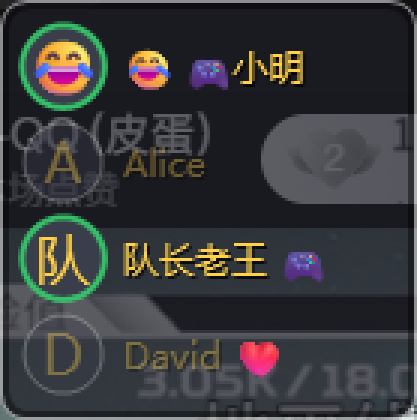

# TS3 Speaking Overlay

**English** | [简体中文](README.md)

A TeamSpeak 3 client plugin that shows **everyone in your current channel** in a
floating, always-on-top overlay — the way KOOK does it. Whoever is talking is
highlighted with a pulsing green ring; everyone else stays in place but is
**dimmed**, so the panel never blinks in and out of existence. The overlay has a
**transparent background** with just a rounded frame around it.



## Features

- **Always on top**: `WS_EX_TOPMOST | WS_EX_LAYERED`, so it shows over games in
  borderless/fullscreen-windowed mode, browsers and players.
- **Background you can adjust**: by default no background is filled (only a
  rounded frame with a dark halo + white stroke, the game shows through
  completely); the settings window can also paint the background and set its
  **opacity (0–100 %)**, e.g. 70 % dark grey when you want more contrast. The
  nickname keeps its 1 px black shadow in every case.
- **Colour and font size are configurable**: text colour (any colour, via the
  `ChooseColor` picker) and font size (8–32 px) live in the **Appearance** group of
  the settings window, take effect immediately, repaint the panel and are written
  to `overlay.ini`.
- **Muting really means not talking**: `STATUS_TALKING_WHILE_DISABLED` and the
  local microphone mute state are both honoured, so pressing TS3's mute button
  removes you from the speaker list immediately — no "still talking while muted"
  ghost.
- **The whole channel**: members come from `getChannelClientList`. Speakers are
  highlighted with a pulsing green ring, the rest are **dimmed but keep their
  slot** (KOOK behaviour) — icons do not vanish when nobody talks.
- **Avatars + nicknames**: fetched through `ts3Functions.getAvatar()` and clipped
  to a circle; clients without an avatar fall back to a coloured initial disc.
- **Colour emoji in nicknames**: nicknames are drawn with Direct2D + DirectWrite
  (`D2D1_DRAW_TEXT_OPTIONS_ENABLE_COLOR_FONT`), so 😂🎮👍❤️ render properly. GDI+
  has no font fallback at all and draws them as empty boxes.
- **Talking ring**: a green pulsing ring on the current speaker; multiple
  simultaneous speakers are ordered by `clientID`, so rows never shuffle.
- **Only while gaming** (can be turned off): the plugin keeps a **game list**;
  the overlay shows as soon as **any enabled game in that list is running** — the
  game does not have to be focused or fullscreen. Steam / Epic / WeGame / GOG /
  Battle.net / EA / Ubisoft are scanned automatically and newly installed games
  start out enabled.
- **The game list is editable**: tick, enable/disable or delete entries in the
  settings window; a deleted game is not re-added by the automatic scan.
- **Snaps to screen edges**: release the drag within 36 px of an edge and it
  aligns itself.
- **Hides only when the channel is empty**: nobody connected / empty channel →
  `SW_HIDE`; as long as members exist the panel stays, just dimmed.
- **Draggable / lockable**: drag with the left button while unlocked, position is
  persisted to `overlay.ini`; when locked it becomes fully click-through
  (`WS_EX_TRANSPARENT`) and clicks reach the game underneath.
- **No taskbar button, no focus stealing**: `WS_EX_TOOLWINDOW | WS_EX_NOACTIVATE`.
- **No server-side permissions needed**: it is a pure client plugin, nothing has
  to be installed on the server.
- **Both bitnesses ship**: 64-bit clients (3.6.x) need API 26, 32-bit clients
  (≤3.5.x) need API 25. The installer picks the right one automatically.

## One-click install (recommended)

Download `TS3SpeakingOverlay-Setup.exe` from the
[latest release](../../releases/latest)
and run it. It is a **single file with both plugin DLLs embedded** and needs **no
runtime redistributable** (statically linked with MinGW; the only runtime import
is the system's own `msvcrt.dll`).


- Finds TeamSpeak 3 automatically, trying in this order: **running TS3 process →
  registry `HKCU\Software\TeamSpeak 3 Client` → the usual folders on every fixed
  drive (`teamspeak`, `TeamSpeak3`, `ts3`, `Program Files\TeamSpeak 3 Client`, …)
  → a depth-limited scan of each drive root (2 levels)**. Both portable installs
  (config in `<TS3>\config`) and standard installs (config in
  `%APPDATA%\TS3Client`) are supported.
- **Detects the client bitness** by reading the PE header of the client exe and
  installs `ts3_speaking_overlay_win64.dll` (API 26) or
  `ts3_speaking_overlay_win32.dll` (API 25) accordingly.
- **If it cannot find TS3**: click **"手动选择目录…" (Choose folder…)** and point
  it at either the client folder or the config folder — all three of these work:
  - `C:\TeamSpeak3` (contains `config\`) → portable install
  - `C:\TeamSpeak3\config` (contains `plugins\`) → used directly as config dir
  - `C:\TeamSpeak3\config\plugins` → the parent is taken
- Stops TS3 → installs the DLL → backs up `addons.ini` to
  `addons.ini.ts3ovl.bak` → writes the registration → restarts TS3.
- Buttons: **Install / Uninstall / Choose folder… / Restart TS3 only / Close**.
  Uninstall removes the DLL and the registration line.
- After installation the overlay defaults to **"only while gaming"**. Enter a game,
  or switch it off via `Plugins(P) → Speaking Overlay → 仅游戏内显示`, to see it on
  the desktop.
- When TS3 is not found the log pane prints **diagnostics** (registry default
  value, how many processes are visible), so you can see which step missed.

Silent mode (for scripts / remote deployment):

```bat
TS3SpeakingOverlay-Setup.exe /silent /install
TS3SpeakingOverlay-Setup.exe /silent /uninstall
```

Exit codes: `0` success, `2` TeamSpeak 3 not found, `3` could not stop TS3,
`4` failed to extract the DLL, `5` failed to copy, `6` failed to write
`addons.ini`.

> **If it says "can only see N processes / running at low integrity level"**: the
> folder this EXE lives in carries a *Low* integrity label, so the process cannot
> read the process list and cannot write into the TS3 folder. Copy the installer
> to a normal folder (e.g. the Desktop) and run it from there, or clear the label
> on the folder:
> `icacls <folder> /setintegritylevel "(OI)(CI)Medium" /T`.

## Manual install

1. Close TeamSpeak 3.
2. Pick the DLL matching your client's bitness:
   - 64-bit client (TS3 3.6.x, `ts3client_win64.exe`) →
     `ts3_speaking_overlay_win64.dll`
   - 32-bit client (TS3 ≤3.5.x, `ts3client.exe`) →
     `ts3_speaking_overlay_win32.dll`
3. Put it into `%APPDATA%\TS3Client\plugins\` (portable: `<TS3 folder>\config\plugins\`).
4. Open the sibling `addons.ini` and add one line under the `[plugin]` section
   (the file name must match the DLL from step 2):

   ```ini
   SpeakingOverlay\files=ts3_speaking_overlay_win64.dll
   ```

5. Start TS3 → Settings → Addons and make sure "Speaking Overlay" is enabled.

## Usage

Plugin menu (the **Plugins(P)** menu of TS3):


| Menu item | Effect |
| --- | --- |
| 显示/隐藏浮窗 (Show/hide overlay) | Temporarily hides the overlay, the plugin keeps running |
| 仅游戏内显示：开/关 (Only while gaming) | When on, the overlay only appears while a game is in the foreground (default: on) |
| 锁定/解锁浮窗位置 (Lock position) | When locked the overlay is click-through, clicks land in the game below |
| 重置浮窗位置 (Reset position) | Back to the right edge, vertically centred |
| 打开设置（查看/切换全部开关）… (Open settings) | Opens the settings window, which always shows whether each switch is on or off |

### Settings window: seeing every switch state at a glance

TS3's `PluginMenuItem` struct has **no checked/state field**, the client calls
`ts3plugin_initMenus` **exactly once per process** (opening the menu does not
call it again) and it frees the menu array through `ts3plugin_freeMemory`
immediately afterwards — writing to `item->text` later is a use-after-free and
crashes the client. A native menu item therefore **can never show live states**.

The plugin uses the client's real configuration entry point instead
(`ts3plugin_offersConfigure` returns `PLUGIN_OFFERS_CONFIGURE_NEW_THREAD` plus a
`ts3plugin_configure` implementation). Two ways to open it:

- **Plugins(P) → Speaking Overlay → 打开设置（查看/切换全部开关）…**
- **Settings → Addons → select Speaking Overlay → Settings**


The window has four blocks: the three checkboxes at the top control
show / only-while-gaming / lock; the **appearance** group holds text colour, the
background colour, the background-opacity slider, the font-size combo and "restore
the default look"; the **game list** group holds the list plus one button row (add
current foreground program / browse for an exe… / scan installed games / enable /
disable / remove from list); the **check for updates** group holds the current
version, the check button, the release-page button, the status text and
download-and-install. Nothing overlaps, the window resizes freely (minimum 760×700)
and the button row always sits directly under the list.

The status line at the bottom tells you whether the overlay is actually on screen
right now (and whether it is being hidden by "only while gaming"). The window
re-syncs once per second, so it also follows changes made from the menu.

> The first four menu items still toggle things at any time — their captions are
> fixed action labels, so look at the settings window for the current state.

**Drag + snap**: while unlocked just drag the overlay with the left button.
Releasing within 36 px of a screen edge snaps it to that edge. Position is stored
in `overlay.ini` (plugin folder, `[overlay]` section: `x`, `y`, `locked`,
`onlyInGame`).

### Look: background, text colour and font size are configurable

By default the overlay draws **no background fill** — just a rounded frame (an
outer dark halo plus an inner white stroke), so the game shows through completely.
Every name is drawn twice in Direct2D (a 1 px near-black shadow, then the main
text), which keeps it readable over bright scenes.

The **Appearance** group in the settings window has four controls, all of which
apply immediately and are written to `overlay.ini` at once:

| Control | Effect | ini key |
| --- | --- | --- |
| Text colour… | colour picker for the nicknames | `textColor=0xAARRGGBB` (alpha forced to FF) |
| Background colour… | colour picker for the panel | `bgColor=0xAARRGGBB` |
| Background opacity | 0–255 slider (shown as a percentage) | the alpha byte of `bgColor` |
| Font size | 8 / 10 / … / 32 px combo | `fontSize=<px>` |

An alpha of 0 in `bgColor` means no background at all (the default); "restore the
default look" puts back transparent / white text / 12 px.

> Changing the look posts `WM_APP_REBUILD_TEXT` so `TeardownTextEngine()` runs on
> the overlay's own thread before the DirectWrite format objects are rebuilt —
> touching D2D objects across threads crashes. If a bigger font pushes the panel
> off-screen it is clamped back into the monitor work area.

### How "only while gaming" is decided

The foreground window is no longer consulted. `src/games.cpp` keeps a **game
list** and enumerates running processes every 400 ms: the overlay is shown as
soon as **any enabled executable in that list is running**, regardless of focus,
fullscreen mode or window mode. Consequences:

- a game running in the background (you alt-tabbed to a browser) still shows the
  overlay;
- a game that is not running never makes the overlay appear, even when focused;
- matching is by lower-cased executable name only, e.g. `cs2.exe`.

There are four ways an entry gets into the list:

1. **Automatic scan** (on by default): once 15 s after startup and then every
   60 s, newly installed games are added and **default to enabled**. The scanner
   understands Steam (`libraryfolders.vdf` + `appmanifest_*.acf`), Epic
   (`LauncherInstalled.dat` + `Manifests\*.item`), GOG (registry), Battle.net, EA,
   Ubisoft, plus `WeGameApps` / `Epic Games` / `GOG Games` / `XboxGames` /
   `Riot Games` / `Games` trees on every fixed drive.
2. **Desktop / Start-menu shortcuts**: portable, zip-installed games that no
   launcher knows about can only be found through their `.lnk`. Both desktop
   folders and both Start-menu folders are resolved through `IShellLinkW`. A
   shortcut that points at an `.ico` or a directory falls back to that folder and
   picks its main executable (measured case: a shortcut pointing at `logo.ico` only
   resolved to the real `*-launcher.exe` through this fallback).
3. **Add current foreground program**: takes the exe of the frontmost window
   (skipping the settings window itself).
4. **Browse for an exe…**: pick any executable manually.

Shortcut scanning needs a **"looks like a game" test**, otherwise `cmd.exe`,
`chrome.exe` and `devenv.exe` all end up in the list (measured: 108 of 141
candidates were tools). The checks live in `LooksLikeGameFolder`
(`src/games.cpp`) and the order is the semantics:

1. under `\windows`, `\program files`, `\appdata\` or `\programdata\` → not a game;
2. engine markers (`UnityPlayer.dll` / `GameAssembly.dll` / `GodotSharp` /
   `Engine\Binaries\Win64` / `Engine\Content` / `Content\Paks`, plus
   `*_Data\globalgamemanagers` one level down) → a game;
3. when the folder itself is `bin` / `win64` / `binaries` / `x64` / `game`, the
   engine markers are looked up in the parent;
4. a `Binaries` / `Engine` / `Win64` / `Game` subfolder **and** at least 400 MB of
   content → a game (this exists for launchers where an Electron shell wraps the
   real payload: the shell folder holds `resources\app.asar` while the actual game
   content sits in sibling `Cross\` / `Launcher\` folders worth hundreds of MB, so
   it must be tested **before** rule 5 or the package is discarded as a plain
   Electron app);
5. an Electron shape (`icudtl.dat` or `resources\app.asar`, one level down) →
   not a game (Doubao, KOOK and WeChat all look like this);
6. a `.pak` / `.rpa` / `.rgss3a` / `.pck` / `.vpk` larger than 40 MB within depth
   2 (skipping `chrome*`, `*_percent*`, `resources.pak` — those are CEF) → a game.

Measured: on a machine whose desktop had 11 game shortcuts (Steam titles plus a mix
of portable and launcher-packed games) all of them were found, while none of the
141 shortcut candidates that were tools (`cmd.exe`, browsers, IDEs, the launchers
themselves) made it in.

Delete an entry with "remove from list" and it lands in an **ignore list**
(`ignored=` inside `[games]` of `overlay.ini`), so the automatic scan will not
bring it back — only an explicit re-add does. The checkbox, "enable" and
"disable" toggle individual games at any time.

The scanner skips obvious non-games: engine helper binaries (`vconsole2.exe`,
`vguimatsurface.exe`), anti-cheat/crash handlers, redistributables
(`vc_redist*.exe`, `dxsetup`, `dotnetfx`), and the launchers themselves (Steam /
Epic / WeGame / GOG Galaxy / Battle.net / EA / Ubisoft / Riot / Xbox) along with
their support folders (`common_apps`, `_CommonRedist`, `dependency_shared`, …).

## Building from source

Requirements:

- **MinGW-w64, x64 and i686, both with the msvcrt runtime** (it ships its own
  Win32 headers and import libraries, no Windows SDK required):
  take `winlibs-x86_64-…-mingw-w64msvcrt-…zip` and
  `winlibs-i686-…-mingw-w64msvcrt-…zip` from
  <https://github.com/brechtsanders/winlibs_mingw/releases>.
- **TeamSpeak 3 plugin SDK headers**:

  ```bat
  git clone https://github.com/teamspeak/ts3client-pluginsdk
  ```

```powershell
# x64 toolchain in C:\dev\mingw64, i686 toolchain in C:\dev\mingw32
.\build.ps1 -Mingw64 C:\dev\mingw64 -Mingw32 C:\dev\mingw32 -Sdk C:\src\ts3client-pluginsdk
.\build-installer.ps1 -Mingw C:\dev\mingw64\bin
```

`build.ps1` stages the sources and SDK headers into an ASCII build directory
(`%TEMP%\ts3ovl_build` and `%TEMP%\ts3ovl_build32` by default) and produces the two
DLLs plus three debugging programs:

| Program | Purpose |
| --- | --- |
| `test_overlay.exe [seconds] [ingame]` | Standalone overlay preview with 4 fake members, 2 talking and 2 dimmed. Pass `ingame` to keep the game gate, otherwise it is switched off |
| `test_gamedetect.exe` | Prints the foreground window details **and the actual game-detection verdict** (same code path as the overlay) |
| `test_gamedetect.exe -all` | Enumerates all visible windows and lists the ones classified as games (to hunt false positives) |
| `test_fakegame.exe [seconds] [windowed]` | Creates a borderless fullscreen (or windowed) fake game window to verify the gate |

`deploy.ps1` is a developer helper for local deployment; `-Ts3Dir` accepts either
the client folder or the config folder:

```powershell
.\deploy.ps1 -Ts3Dir 'C:\Program Files\TeamSpeak 3 Client'
.\deploy.ps1 -Ts3Dir "$env:APPDATA\TS3Client" -DllName ts3_speaking_overlay_win32.dll -NoRestart
```

> **The build directory must be writable.** MinGW's `cc1plus` writes temporary
> files into the working directory and `%TEMP%`. If the checkout lives in a folder
> carrying a Low integrity label, child processes inherit Low IL and cannot write
> anywhere, which shows up as `Cannot create temporary file`. Use `-BuildDir` to
> move it.

## Source layout

| File | Description |
| --- | --- |
| `src/plugin.cpp` | Plugin core: exported symbols, event callbacks, channel member list, name/avatar caches, menus |
| `src/plugin.h` | `PLUGINS_EXPORTDLL` declarations (every export the API requires) |
| `src/overlay.cpp` | The overlay: layered window with GDI+ per-pixel alpha, transparent background + rounded frame, Direct2D text pass, layout, painting, dimming, dragging, snapping, persistence |
| `src/overlay.h` | Public overlay interface (`OverlayStart` / `OverlaySetEntries` / state queries / `OverlaySaveSettings` / …) |
| `src/settings.cpp` | Settings window: three groups (switches / game list / check for updates), controls mirror live state and re-sync every second (the UI behind `ts3plugin_configure`) |
| `src/settings.h` | Settings interface (`SettingsShow` modal / `SettingsShowAsync` on its own thread / `SettingsShowUpdateAsync` / `SettingsClose`) |
| `src/games.cpp` / `src/games.h` | Game list: `[games]` section read/write, process detection (400 ms cache), multi-launcher scan (Steam/Epic/GOG/Battle.net/EA/Ubisoft/WeGame), ignore list |
| `src/update.cpp` / `src/update.h` | Check for updates: WinHTTP against the GitHub Releases API, semantic version compare, download the setup, launch a silent install |
| `src/version.h` | `TS3OVL_VERSION` (defaults to `1.2.0`, override with `-DTS3OVL_VERSION='"..."'`) |
| `src/test_overlay.cpp` | Standalone preview harness with 4 fake speakers |
| `src/test_gamedetect.cpp` | Game-list / process probe reusing the overlay's detection logic |
| `src/test_fakegame.cpp` | Fake borderless-fullscreen game window to verify the gate |
| `src/test_settings.cpp` | Harness that runs the settings window on its own, without TS3 |
| `src/test_update.cpp` | CLI harness for update/scan/process detection (`ver` / `games` / `scan` / `running` / `download` / `check` / `all`) |
| `installer/setup.cpp` | The one-click installer (Win32 GUI: locate TS3, install/uninstall, silent flags) |
| `installer/setup.rc` / `setup.manifest` / `res.h` | Installer resources: icon, both embedded DLL payloads, manifest, version info |
| `installer/make_ico.py` | Builds the multi-size `.ico` from PNG frames |
| `build.ps1` / `build-installer.ps1` / `deploy.ps1` | Build the plugin / package the installer / deploy locally |

### Implementation notes

- The TS3 callback thread only updates a snapshot guarded by `std::mutex`;
  **rendering happens on its own thread**, so a slow GDI call never stalls voice.
- **The DIB must stay selected in the memory DC** when `UpdateLayeredWindow` is
  called. Otherwise ULW reads the DC's 1×1 monochrome stock bitmap, returns
  `ERROR_GEN_FAILURE (31)` and the window never appears — the single biggest trap
  in this project.
- **`WS_EX_TOPMOST` is not permanent — the overlay has to reclaim the z-order.**
  When a fullscreen or borderless-fullscreen game is activated, Windows promotes
  it *above* the topmost band and the panel ends up underneath it. Measured with
  CS2 (`SDL_app`, borderless fullscreen): the overlay sat at `z=288` while cs2 was
  at `z=434` — `IsWindowVisible()` still returned `TRUE`, the layered surface
  still held pixels, a snapshot of the window itself looked perfect, and yet
  nothing was on screen. After restarting the client the z-order happened to be
  the other way round (`20` vs `34`) and the very same binary displayed fine,
  which is why this bug only shows up sometimes and is easily mistaken for a
  rendering problem. Fix: `Paint()` calls `SetWindowPos(hwnd, HWND_TOPMOST, …,
  SWP_NOMOVE | SWP_NOSIZE | SWP_NOACTIVATE | SWP_NOOWNERZORDER)` to put itself
  back into the topmost band, restoring the `WS_EX_TOPMOST` bit if it was cleared.
  To avoid fighting the game (25 `SetWindowPos` calls per second flicker against
  a game that keeps re-ordering its own window) the call only happens when the
  foreground window changed, when the overlay just became visible, or as a 1 Hz
  safety net.
- Click-through only works via `WS_EX_TRANSPARENT`. Returning `HTTRANSPARENT`
  from `WM_NCHITTEST` only forwards to windows of the *same thread* and never
  reaches the application underneath.
- Every GDI+ object is scoped so it is destroyed before `GdiplusShutdown()`;
  otherwise the process crashes with 0xC0000005.
- The `PluginMenuItem**` array **must be NULL-terminated** — that is what the SDK
  sample's `END_CREATE_MENUS` macro does.
- **`ts3plugin_freeMemory` must be defined inside the `extern "C"` block.** Defined
  outside it, C++ name-mangles it to `ts3plugin_freeMemoryPv`, the client cannot
  find the unmangled name and silently concludes the plugin does not support
  menus, so it **never calls `ts3plugin_initMenus`** — no menu, no error message.
  SDK quote: *"Both ts3plugin_registerPluginID and ts3plugin_freeMemory must be
  implemented to use menus."*
- **The menu memory belongs to the client.** Right after `ts3plugin_initMenus`
  returns, the client releases that array through `ts3plugin_freeMemory` (the log
  shows `initMenus: 5 global items created` immediately followed by
  `freeMemory: client released the MENU ARRAY`). So you must **not** keep the
  `PluginMenuItem**` around and rewrite `item->text` later to show checkmarks —
  that is a use-after-free and crashes TS3 the moment you click the menu. SDK's
  `PluginMenuItem` has no `checked` field either, the client draws no checkmark,
  it calls `ts3plugin_initMenus` **once per process only** (opening the menu does
  not call it again), and `setPluginMenuEnabled` does not even exist in the 3.6.2
  client binary. Conclusion: a native menu can never show live state. This plugin
  therefore uses `ts3plugin_offersConfigure` + `ts3plugin_configure` for a real
  settings window (three checkboxes, re-synced every second) and keeps one *Open
  settings…* item in the menu.
- **`ts3plugin_configure` must run its own message loop.** With
  `PLUGIN_OFFERS_CONFIGURE_NEW_THREAD` the client **blocks** in that call until it
  returns, so the window pumps `GetMessage` modally on that thread, and `WM_CLOSE`
  must really `DestroyWindow` (merely hiding it blocks configure forever). Also,
  `qParentWidget` is a Qt `QWidget*`, **not an HWND** — passing it as the parent of
  `CreateWindowExW` makes creation fail, so the window is always top-level and
  centres itself.
- **Opening the settings window from the menu must not block.** Menu events run on
  the client's Qt GUI thread, where a modal loop would freeze TS3, so
  `SettingsShowAsync()` starts the modal `SettingsShow()` on a private thread.
- **Do not depend on UCRT apisets.** A DLL built with the default (UCRT) MinGW
  imports ten `api-ms-win-crt-*.dll` entries, among them
  `api-ms-win-crt-private-l1-1-0.dll`, a private UCRT apiset that is missing on
  Windows 7/8 without the Universal CRT update and on trimmed Windows images.
  `LoadLibrary` then fails with error 126 and the client reports
  *"Failed to read addon info"*. Building against **msvcrt** leaves only
  `d2d1 / DWrite / GDI32 / gdiplus / KERNEL32 / msvcrt / USER32` in the import
  table; `build.ps1` verifies this at the end and aborts if any apiset shows up.
- **The API version must match the bitness**: the 64-bit TS3 3.6.x needs **26**,
  the 32-bit client needs **25**. Handing 26 to a 32-bit client yields
  `Api version is not compatible for plugin: …`, `Failed to load plugin` and the
  same *"Failed to read addon info"* dialog. `src/plugin.cpp` therefore uses
  `#ifndef PLUGIN_API_VERSION`, and `build.ps1` compiles each bitness with
  `-DPLUGIN_API_VERSION=26/25`.
- The manifest resource ID in the installer's `setup.rc` **must not be 1**: MinGW's
  `ld` appends its own `default-manifest.o` (with ID 1) and two non-default
  manifests make the linker fail with
  `.rsrc merge failure: multiple non-default manifests`.
- The installer is **self-extracting**: both plugin DLLs are embedded as `RCDATA`
  (resource ID 101 = x64, 102 = x86) and the right one is written to `plugins/` at
  runtime, which is why the release is a single EXE.
- **The most common reason the installer "cannot find TeamSpeak 3" is the process
  integrity level.** An EXE carrying a Low integrity label runs with reduced
  rights and the measured consequences are: the registry is readable,
  `GetFileAttributesW` works, but `CreateToolhelp32Snapshot` **sees no TS3 process
  at all** (so "look for a running client" always fails) and `CopyFileW` into the
  TS3 `config\plugins` folder returns `ERROR_ACCESS_DENIED (5)`. The installer now
  detects "fewer than 8 visible processes" and says so, and it has a real
  *Choose folder…* button. Fix the root cause with
  `icacls <folder> /setintegritylevel "(OI)(CI)Medium" /T` or copy the EXE to a
  normal folder. Note that `icacls ... /setintegritylevel` **fails when applied to
  a subfolder alone** — add an explicit ACE first, then recurse with `/T`.
- Locating TS3 cannot rely on the uninstall registry: a portable install writes
  **no uninstall entry**, and `%APPDATA%\TS3Client` may not exist (config lives in
  `<TS3>\config`). The search chain is therefore: running process → registry
  `HKCU\Software\TeamSpeak 3 Client` default value → usual folders on fixed
  drives → depth-limited scan (skipping reparse points and dot-directories so it
  never degenerates into a full disk walk).
- **Nicknames cannot go through GDI+.** GDI+ has no font fallback whatsoever:
  `DrawString` renders characters missing from `Microsoft YaHei UI` (i.e. emoji)
  as empty boxes. The renderer is therefore **two passes**: GDI+ draws the panel
  gradient, avatars and ring, then an
  `ID2D1DCRenderTarget::BindDC(memDc)` pass draws the text with
  `DrawTextW(..., D2D1_DRAW_TEXT_OPTIONS_ENABLE_COLOR_FONT, ...)` onto the *same*
  memory DC, which is the only way to get colour emoji. Two preconditions were
  verified experimentally: D2D writes correct premultiplied alpha (it does not
  make the panel opaque) and it **blends over** existing GDI+ content instead of
  erasing it. Text measurement must also go through
  `IDWriteTextLayout::GetMetrics`, otherwise emoji widths are wrong. The initial
  letter on the fallback disc is drawn through D2D as well (`DrawInitialsD2D`)
  because many TS3 nicknames start with an emoji; emoji are surrogate pairs, so
  the first character must be taken as two UTF-16 units or you get half a glyph.
- The text render target uses `D2D1_TEXT_ANTIALIAS_MODE_GRAYSCALE`, because
  ClearType produces coloured fringes on per-pixel alpha edges.
- **Dimming is done in two places**, because rendering has two passes: avatars and
  the GDI+ text fall back to a `ColorMatrix` that scales alpha
  (`cm.m[3][3] = a/255`; note MinGW's `ColorMatrix` is a bare `REAL[5][5]` that
  must be `ZeroMemory`'d and filled field by field — aggregate initialisation
  fails with `too many initializers`), while the Direct2D pass switches to a brush
  with alpha (`g_d2dDim`). Both must change, or you end up with "avatar dimmed but
  name still bright".
- When idle the timer drops to 250 ms (`kIdleMs`) but **must keep ticking**: the
  same timer re-evaluates the "only while gaming" gate, and stopping it would make
  the overlay never reappear when you switch back into a game.
- **An empty path from `getAvatar` is not a failure.** It has four outcomes:
  `ERROR_ok` + non-empty path = cached and usable; `ERROR_ok` + **empty path** =
  the member *has* an avatar but the image has not been downloaded yet, and the
  client downloads it and then fires `ts3plugin_onAvatarUpdated`;
  `ERROR_database_empty_result` = no avatar set; anything else = a hard failure.
  An early version treated the empty path as a failure and recorded it
  **permanently**, so the very first query (right after joining, before the avatar
  was cached) killed it for good and avatars never appeared. Now only the two
  **definitive** answers are cached (path present / no avatar); "not downloaded
  yet" is re-asked every frame, and
  `requestInfoUpdate(handler, PLUGIN_CLIENT, clientID)` nudges the download.
  `ts3plugin_onAvatarUpdated` must be implemented to invalidate the cache and call
  `Refresh()`, otherwise the UI never updates after the download completes.
- **A look change must rebuild the text engine on the overlay thread.** The
  settings window runs on another thread and the DirectWrite `IDWriteTextFormat`
  and D2D brush objects belong to the thread that created them.
  `OverlaySetAppearance()` only writes the shared state and posts
  `WM_APP_REBUILD_TEXT`; the overlay thread then runs `TeardownTextEngine()` and
  rebuilds with the new font size. Releasing them from another thread crashes. The
  "already initialised, return early" check in `InitTextEngine` must also compare
  `g_d2dFontPx` and `g_d2dTextColor`, otherwise a size/colour change is treated as
  a no-op.
- **A muted microphone must not keep you in the speaker list.**
  `ts3plugin_onTalkStatusChangeEvent` has three statuses: `STATUS_NOT_TALKING(0)`,
  `STATUS_TALKING(1)` and `STATUS_TALKING_WHILE_DISABLED(2)`. An early version
  treated every non-zero value as talking, so after pressing mute the client kept
  sending `status=2` and the overlay kept a green ring lit. Now the code asks
  `getClientID` whether the event is about us, then reads
  `getClientSelfVariableAsInt(handler, CLIENT_INPUT_MUTED, …)`; only
  `status == STATUS_TALKING && !selfMuted` counts. It also implements
  `ts3plugin_onClientSelfVariableUpdateEvent` and drops the local client as soon as
  `flag == CLIENT_INPUT_MUTED(5)` (or `CLIENT_INPUT_DEACTIVATED`) becomes non-zero,
  so even a late status event cannot leave a stale ring. Measured log:
  `selfMuted=1` 51 times, `status=2` 26 times, and "`selfMuted=1` **and**
  `status=1`" **0 times**.
- **Shortcut scanning must call `CoInitializeEx` first.** `ShortcutExes()` resolves
  `.lnk` files through `IShellLinkW` + `IPersistFile`; on a thread without COM
  initialised, `CoCreateInstance(CLSID_ShellLink)` returns
  `CO_E_NOTINITIALIZED (0x800401F0)` and the scan **silently returns zero** (the
  first version reported `0 new` with no error at all). The function now calls
  `CoInitializeEx(NULL, COINIT_APARTMENTTHREADED)` / `CoUninitialize()` itself.
  Linking also needs `-luuid`, otherwise `IID_IShellLinkW` / `IID_IPersistFile` are
  undefined.
- **Strip the DLL (`-s`).** Without it MinGW appends 24k static-runtime symbol names
  (the COFF symbol table, ~917 KB) to the end of the file, pointed at by PE+12 — 60 %
  of the 1.5 MB DLL was junk the client never reads.
- **`WritePrivateProfileSectionW` rewrites the whole ini.** Writing the `[games]`
  section with it wipes the `[overlay]` section (position, lock, colours). So
  `GamesSave()` instead reads the whole file, replaces only the target section and
  writes it back, keeping every other section intact.

## Known limitations

- Avatars come from the client's local `getAvatar` cache; members without an
  avatar show an initial disc (the initial is drawn with Direct2D too, so emoji
  initials work).
- Avatar files are downloaded and cached by the client, so the first time you see
  somebody an initial disc may appear and be replaced once `onAvatarUpdated`
  arrives.
- Only the "current server connection + current channel" is handled; with several
  simultaneous server connections the active one is shown.
- Channels larger than 12 members (`kMaxRows`) show the first 12 rows; speakers
  are moved to the top, so whoever is talking is never cut off.
- Refresh rate is about 25 fps (40 ms timer) only while somebody talks; when
  everyone is silent it drops to 4 fps (250 ms), which merely re-evaluates the
  game gate.
- Game detection only checks whether an executable on the list is running; it does
  not inspect window shapes or query the GPU driver. The list is built by the
  automatic scan plus manual additions; **the first scan runs 15 s after the
  plugin starts**, so a game already running before that may not show the overlay
  immediately — add it manually or wait a moment.
- The automatic scanner covers the default install locations of the common
  launchers (Steam/Epic/GOG/Battle.net/EA/Ubisoft/WeGame) plus desktop and
  Start-menu shortcuts. Games installed in unusual folders without a shortcut must
  be added with "browse for an exe…" in the settings window.
- The shortcut "looks like a game" test is heuristic: it relies on engine markers,
  a large content archive and the Electron shape. A custom engine or a hand-rolled
  package may slip through; add those once with "browse for an exe…".
- The overlay is local to the machine running TeamSpeak 3; nothing is synchronised
  through the server.

## License

The code in this repository is released under the MIT license, see
[LICENSE](LICENSE).

The *TeamSpeak 3 client plugin SDK* headers are not part of this repository and
remain copyright TeamSpeak Systems GmbH
(<https://github.com/teamspeak/ts3client-pluginsdk>); clone them at build time.
TeamSpeak is a trademark of TeamSpeak Systems GmbH; this project is not
affiliated with it.
