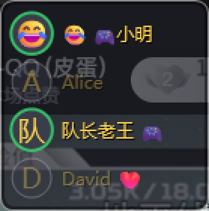
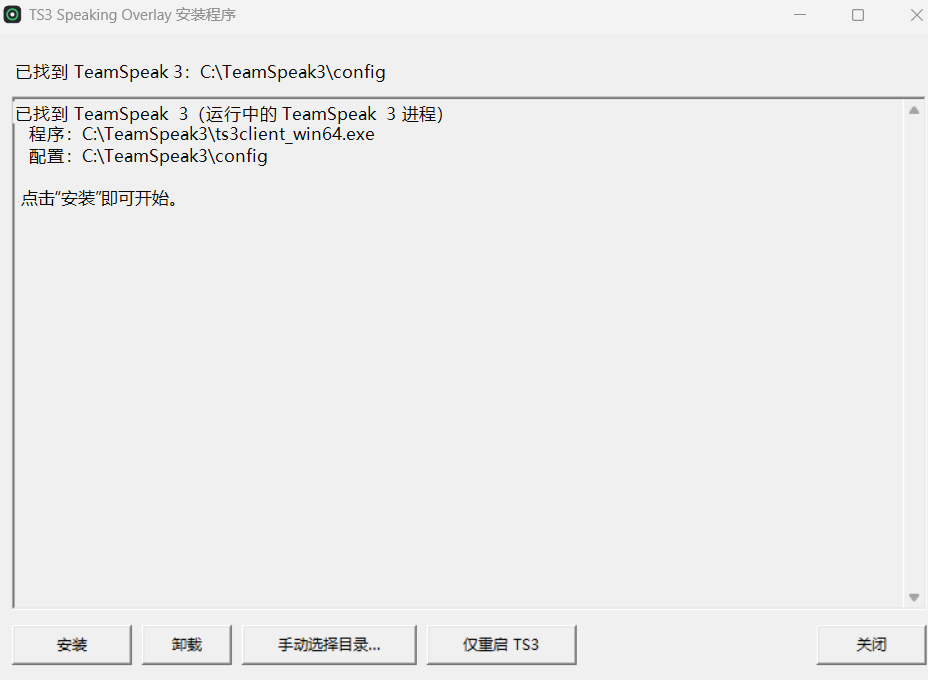
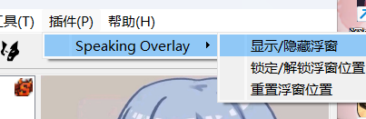
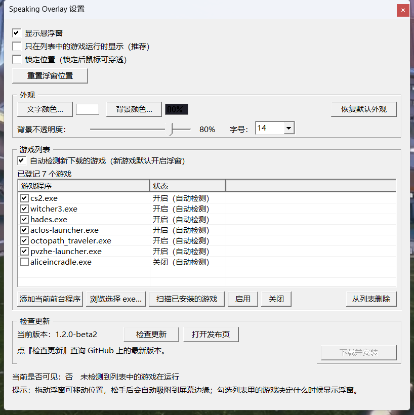

# TS3 Speaking Overlay

[English](README.en.md) | **简体中文**

一个 TeamSpeak 3 客户端插件：像 KOOK 那样，在屏幕上层用悬浮窗实时显示**当前频道里的所有人**——正在说话的人高亮并带呼吸绿环，没说话的人保持原位但**变暗**，不会整块消失。浮窗**背景透明**，只留一圈圆角边框。



## 特性

- **悬浮在最上层**：`WS_EX_TOPMOST | WS_EX_LAYERED`，游戏全屏窗口化、浏览器、播放器上都能显示。
- **背景可调**：默认不画背景（只有一圈圆角边框，深色光晕 + 白色描边，游戏画面完全透出）；也可以在设置窗口里给背景上色并调**不透明度 0–100%**，比如设成 70% 的深灰让文字更好读。昵称始终带 1px 黑色描边。
- **颜色 / 字号都能改**：文字颜色（任意颜色，`ChooseColor` 取色器）与字号（8–32 px）在设置窗口「外观」组里实时生效，改完立刻重绘并写进 `overlay.ini`。
- **静音时就真的不说话了**：`STATUS_TALKING_WHILE_DISABLED` 与本地麦克风静音状态都会被检查，按下 TS3 的静音键后自己立刻从说话列表里移除，不会出现"关了麦浮窗还在说我说话"。
- **显示自己频道里的所有人**：用 `getChannelClientList` 取本频道成员；说话的人高亮 + 呼吸绿环，其余人**变暗但保留在原位**（KOOK 的行为），图标不会因为没人说话而突然消失。
- **头像 + 昵称**：通过 `ts3Functions.getAvatar()` 取客户端头像并裁成圆形；没有头像时退化成"首字彩色圆盘"。
- **支持 emoji 昵称**：昵称文字走 Direct2D + DirectWrite 彩色字体渲染，😂🎮👍❤️ 等 emoji 正常显示（GDI+ 没有字体回退，会把 emoji 画成空框）。
- **讲话呼吸环**：说话的人有绿色脉冲圆环，多人同时说话按 clientID 稳定排序，不会跳来跳去。
- **只在游戏内出现**（可关）：维护一份游戏名单，**名单里的游戏进程一启动就显示**（不要求前台、不要求全屏）；自动扫描 Steam / Epic / WeGame / GOG / Battle.net / EA / Ubisoft，新装游戏默认开启。
- **游戏名单可手动管理**：设置窗口里勾选、启用/关闭、从列表删除；删掉的不再被自动扫描加回来。
- **贴近屏幕边缘自动吸附**：拖到距边缘 36px 以内松手，自动贴边对齐。
- **离开频道才隐藏**：频道里没人（未连接 / 频道空）时整个窗口 `SW_HIDE`；只要还有成员就常驻，没人说话时只是全部变暗。
- **可拖动 / 可锁定**：解锁时左键拖动换位置，位置写进 `overlay.ini`；锁定后 `WS_EX_TRANSPARENT` 完全鼠标穿透，点击落到游戏里。
- **不占任务栏、不抢焦点**：`WS_EX_TOOLWINDOW | WS_EX_NOACTIVATE`。
- **无需服务端权限**：全部走客户端插件 SDK，服务器不需要装任何东西。
- **同时提供 64 位与 32 位 DLL**：64 位客户端（3.6.x）用 API 26，32 位客户端（≤3.5.x）用 API 25，安装器会自动识别。

## 一键安装（推荐）

双击 `dist/TS3SpeakingOverlay-Setup.exe` 即可，**单文件、已内嵌两个插件 DLL、无需任何运行库**（静态链接 MinGW，只依赖系统自带的 `msvcrt.dll`）。



- 自动找到 TS3，按这个顺序试：**运行中的 TS3 进程 → 注册表 `HKCU\Software\TeamSpeak 3 Client` → 各固定盘的常见目录（teamspeak / TeamSpeak3 / ts3 / Program Files\TeamSpeak 3 Client …）→ 限深扫描各盘根目录（最多 2 层）**。便携版（配置在 `<TS3>\config`）和标准安装（配置在 `%APPDATA%\TS3Client`）都支持。
- **自动识别客户端位数**：读客户端 exe 的 PE 头，64 位装 `ts3_speaking_overlay_win64.dll`（API 26），32 位装 `ts3_speaking_overlay_win32.dll`（API 25）。
- **找不到时不用慌**：点界面上的「手动选择目录…」，选 TS3 的安装目录或 `config` 目录都行——三种都能识别：
  - 选了 `C:\TeamSpeak3`（下面有 `config\`）→ 便携版
  - 选了 `C:\TeamSpeak3\config`（下面有 `plugins\`）→ 直接当配置目录
  - 选了 `C:\TeamSpeak3\config\plugins` → 自动往上取一级
- 自动关掉 TS3 → 装 DLL → 备份 `addons.ini` 为 `addons.ini.ts3ovl.bak` → 写入注册项 → 重新启动 TS3。
- 界面里有「安装 / 卸载 / 手动选择目录… / 仅重启 TS3 / 关闭」，卸载会删 DLL 并清掉注册项。
- 安装完成后浮窗默认**只在游戏内出现**，先在游戏里，或按 `插件(P) → Speaking Overlay → 仅游戏内显示` 关掉它就能在桌面看到。
- 找不到 TS3 时日志区会自动打印**诊断信息**（注册表默认值、能看到多少个进程），可以直接看出是哪一步没命中。

静默安装（给批处理/远程用）：

```bat
TS3SpeakingOverlay-Setup.exe /silent /install
TS3SpeakingOverlay-Setup.exe /silent /uninstall
```

返回码：`0` 成功、`2` 没找到 TS3、`3` 无法关闭 TS3、`4` 释放 DLL 失败、`5` 复制失败、`6` 写 `addons.ini` 失败。

> **如果提示"只能看到 N 个进程 / 运行在低完整性级别下"**：说明这个 EXE 所在目录带了 Low 完整性标签，进程无法读取进程列表、也无权写入 TS3 目录。把安装器**复制到一个普通文件夹（例如桌面）**再运行即可；或者对该目录执行
> `icacls <目录> /setintegritylevel "(OI)(CI)Medium" /T` 把这个标记去掉。

## 手动安装

1. 关闭 TeamSpeak 3。
2. 按客户端位数选 DLL：
   - 64 位客户端（TS3 3.6.x，`ts3client_win64.exe`）→ `ts3_speaking_overlay_win64.dll`
   - 32 位客户端（TS3 ≤3.5.x，`ts3client.exe`）→ `ts3_speaking_overlay_win32.dll`
3. 把 DLL 放进 `%APPDATA%\TS3Client\plugins\`（便携版是 `<TS3目录>\config\plugins\`）。
4. 用文本编辑器打开同级的 `addons.ini`，在 `[plugin]` 段落下加一行（文件名要和第 2 步放的 DLL 一致）：

   ```ini
   SpeakingOverlay\files=ts3_speaking_overlay_win64.dll
   ```

5. 启动 TS3 → 设置 → 附加组件，确认 "Speaking Overlay" 已勾选。

## 使用

插件菜单（TS3 顶部 **插件(P)** 菜单）：



| 菜单项 | 作用 |
| --- | --- |
| 显示/隐藏浮窗 | 临时关掉浮窗，不影响插件运行 |
| 仅游戏内显示：开/关 | 开启后只有前台是游戏时才出现（默认开启） |
| 锁定/解锁浮窗位置 | 锁定后鼠标穿透，点击直接落到下面的游戏/程序 |
| 重置浮窗位置 | 回到屏幕右侧居中 |
| 打开设置（查看/切换全部开关）… | 打开设置窗口，一眼看到每个开关当前是开还是关 |

### 设置窗口：直接看到每个开关的状态

TS3 的 `PluginMenuItem` 结构体**没有 checked/勾选字段**，客户端**每个进程只调用一次** `ts3plugin_initMenus`（打开菜单不会重新调用），而且菜单数组在 `initMenus` 返回后立刻被 `ts3plugin_freeMemory` 释放（事后改写 `item->text` 是 use-after-free，会直接崩溃客户端）。所以原生菜单项**永远无法显示实时开关状态**。

因此本插件改用客户端提供的正规入口 —— 插件设置窗口（`ts3plugin_offersConfigure` 返回 `PLUGIN_OFFERS_CONFIGURE_NEW_THREAD` + 实现 `ts3plugin_configure`），有两个打开方式：

- **插件(P) → Speaking Overlay → 打开设置（查看/切换全部开关）…**
- **设置 → 附加组件 → 选中 Speaking Overlay → 设置**



窗口分四块：上面三个复选框控制显示/只在游戏内/锁定；「外观」分组里是文字颜色、背景颜色、背景不透明度滑块、字号下拉和「恢复默认外观」；「游戏列表」分组里是名单 + 一行按钮（添加当前前台程序 / 浏览选择 exe… / 扫描已安装的游戏 / 启用 / 关闭 / 从列表删除）；「检查更新」分组里是当前版本、检查更新、打开发布页、状态文字和下载并安装。所有控件都不会互相重叠，窗口可以自由缩放（最小 760×700），按钮行始终贴在列表下方。

底部状态行告诉你浮窗当前是否真的在屏幕上（以及是否正被「仅游戏内显示」挡着）。窗口每秒自动同步一次，即使状态是从菜单改的也会跟着更新。

> 菜单里的前 4 项依旧可以随时切换，只是它们的**文字是固定的动作描述**，状态请看设置窗口。

**拖动 + 吸附**：解锁状态下直接用左键拖悬浮窗即可，松手时如果距屏幕边缘 36px 以内会自动贴边对齐，位置保存到 `overlay.ini`（在插件目录，`[overlay]` 段落里的 `x` / `y` / `locked` / `onlyInGame`）。

### 外观：背景、文字颜色、字号都能改

浮窗默认**不画背景填充**，只有一圈圆角边框（外层深色光晕 + 内层白色描边），所以游戏画面完全透出来。昵称文字额外画了一层 1px 黑色描边（Direct2D 双层绘制），透明背景上的白字也能读清。

设置窗口的「外观」组里有四项，全部**即时生效**并立刻写进 `overlay.ini`：

| 控件 | 作用 | ini 键 |
| --- | --- | --- |
| 文字颜色… | 取色器选昵称颜色 | `textColor=0xAARRGGBB`（alpha 强制 FF） |
| 背景颜色… | 取色器选面板底色 | `bgColor=0xAARRGGBB` |
| 背景不透明度 | 0–255 滑块（显示百分比） | 改的是 `bgColor` 的 alpha 字节 |
| 字号 | 8 / 10 / … / 32 px 下拉 | `fontSize=<px>` |

`bgColor` 的 alpha 为 0 时完全不画背景（默认）；「恢复默认外观」把三项恢复成「透明背景 / 白色文字 / 12 px」。

> 改外观时插件会 `PostMessage(WM_APP_REBUILD_TEXT)` 把 `TeardownTextEngine()` 拉回浮窗自己的线程再重建 DirectWrite 格式对象——跨线程直接碰 D2D 对象会崩。字号变大后如果窗口超出屏幕，位置会自动夹回工作区内。

### "只在游戏内显示"是怎么判定的

不再看前台窗口了。`src/games.cpp` 维护一份**游戏名单**，每 400ms 枚举一次进程列表：**名单里任何一个"已开启"的 exe 正在运行，浮窗就显示**，跟谁有焦点、是不是全屏、是不是窗口化全部无关。所以：

- 游戏在后台跑着（你切出去看网页）浮窗照样显示；
- 没在跑的游戏即使在前台也不会让浮窗出现；
- 判定只认 exe 文件名（小写），例如 `cs2.exe`。

名单有三种来源：

1. **自动扫描**（默认开启）：插件启动 15 秒后扫一次，之后每 60 秒扫一次，把新装的游戏加进来，**新加的一律默认开启浮窗**。扫描器支持 Steam（`libraryfolders.vdf` + `appmanifest_*.acf`）、Epic（`LauncherInstalled.dat` + `Manifests\*.item`）、GOG（注册表）、Battle.net、EA、Ubisoft，以及各固定盘的 `WeGameApps` / `Epic Games` / `GOG Games` / `XboxGames` / `Riot Games` / `Games` 等目录树。
2. **桌面 / 开始菜单快捷方式**：绿色版、免安装、启动器不认识的游戏只能靠 `.lnk` 找到。扫描器会解析桌面（两份）与开始菜单（两份）里的快捷方式，取目标 exe。快捷方式指向 `.ico` / 目录这类非 exe 的情况会退回该目录再找主 exe（实测有个游戏的快捷方式指向 `logo.ico`，靠这一步才拿到真正的 `*-launcher.exe`）。
3. **添加当前前台程序**：把现在最前面那个窗口的 exe 加进名单（会自动跳过设置窗口自己）。
4. **浏览选择 exe…**：手动指定任意 exe。

快捷方式这条路必须做**「像游戏」判定**，否则 `cmd.exe`、`chrome.exe`、`devenv.exe` 都会被加进来（实测 141 个候选里 108 个是工具）。判定顺序（`src/games.cpp` 的 `LooksLikeGameFolder`，顺序即语义）：

1. 命中 `\windows`、`\program files`、`\appdata\`、`\programdata\` → 不是游戏；
2. 目录里有引擎标记（`UnityPlayer.dll` / `GameAssembly.dll` / `GodotSharp` / `Engine\Binaries\Win64` / `Engine\Content` / `Content\Paks`，含一层子目录里的 `*_Data\globalgamemanagers`）→ 是游戏；
3. 目录名是 `bin` / `win64` / `binaries` / `x64` / `game` 时再看父目录的引擎标记；
4. 有 `Binaries` / `Engine` / `Win64` / `Game` 目录**且**目录内容 ≥400 MB → 是游戏（这条专为「Electron 外壳包着游戏负载」的启动器准备：外壳目录里有 `resources\app.asar`，真正的游戏内容在旁边的 `Cross\` / `Launcher\` 里，加起来几百 MB，必须先于第 5 步判，否则会被当成普通 Electron 应用丢掉）；
5. 有 Electron 形状（`icudtl.dat` 或 `resources\app.asar`，含一层子目录）→ 不是游戏（豆包、KOOK、微信都长这样）；
6. 深度 2 内存在 >40 MB 的 `.pak` / `.rpa` / `.rgss3a` / `.pck` / `.vpk`（跳过 `chrome*`、`*_percent*`、`resources.pak`，那是 CEF 的东西）→ 是游戏。

实测：一个桌面上有 11 个游戏快捷方式（Steam 系 + 各种绿色版 / 启动器版）的机器上全部命中，141 个快捷方式候选里的工具类（`cmd.exe`、浏览器、IDE、启动器本身）一个都没进来。

不需要的游戏在设置窗口里点「从列表删除」即可；被删掉的会进**忽略名单**（`overlay.ini` 里 `[games]` 的 `ignored=`），自动扫描不会再把它加回来，除非你手动再添加一次。勾选框 / 「启用」「关闭」可以随时开关单个游戏。

扫描器会跳过一堆明显的非游戏程序：引擎辅助程序（`vconsole2.exe`、`vguimatsurface.exe`）、反作弊、崩溃上报、运行库安装包（`vc_redist*.exe`、`dxsetup`、`dotnetfx`）、以及各家启动器本身（Steam / Epic / WeGame / GOG Galaxy / Battle.net / EA / Ubisoft / Riot / Xbox）和它们的依赖目录（`common_apps`、`_CommonRedist`、`dependency_shared` 等）。

## 从源码构建

需要：

- **MinGW-w64 x64 + i686，且必须是 msvcrt 运行时版本**（自带 Win32 头文件与导入库，无需 Windows SDK）：
  <https://github.com/brechtsanders/winlibs_mingw/releases> 里的 `winlibs-x86_64-…-mingw-w64msvcrt-…zip` 与 `winlibs-i686-…-mingw-w64msvcrt-…zip`。
- **TeamSpeak 3 插件 SDK 头文件**：

  ```bat
  git clone https://github.com/teamspeak/ts3client-pluginsdk
  ```

```powershell
# x64 装到 C:\dev\mingw64，i686 装到 C:\dev\mingw32
.\build.ps1 -Mingw64 C:\dev\mingw64 -Mingw32 C:\dev\mingw32 -Sdk C:\src\ts3client-pluginsdk
.\build-installer.ps1 -Mingw C:\dev\mingw64\bin
```

`build.ps1` 会把源码与 SDK 头文件 stage 到一个 ASCII 构建目录（默认 `%TEMP%\ts3ovl_build`、`%TEMP%\ts3ovl_build32`）再编译，产物是两个 DLL，另外还编译三个调试程序：

| 程序 | 用途 |
| --- | --- |
| `test_overlay.exe [秒] [ingame]` | 独立预览浮窗（塞 4 个假成员，其中 2 个说话、2 个变暗）。传 `ingame` 保留"仅游戏内显示"闸门，否则自动关掉 |
| `test_gamedetect.exe` | 打印当前前台窗口信息 + **游戏判定的实际结论**（和浮窗用同一份代码） |
| `test_gamedetect.exe -all` | 枚举所有可见窗口，列出被判为"游戏"的窗口（用来查误判） |
| `test_fakegame.exe [秒] [windowed]` | 造一个无边框全屏 / 窗口化的假游戏窗口，用来验证"进游戏才显示" |

`deploy.ps1` 是开发者用的本地部署脚本，`-Ts3Dir` 指向客户端目录或 `config` 目录都可以：

```powershell
.\deploy.ps1 -Ts3Dir 'C:\Program Files\TeamSpeak 3 Client'
.\deploy.ps1 -Ts3Dir "$env:APPDATA\TS3Client" -DllName ts3_speaking_overlay_win32.dll -NoRestart
```

> **构建目录必须可写**：MinGW 的 `cc1plus` 需要往工作目录和 `%TEMP%` 写临时文件。如果工程放在带 Low 完整性标签的目录里，子进程继承 Low IL 后无法写任何文件，会报 `Cannot create temporary file`。构建目录可以用 `-BuildDir` 换。

## 源码结构

| 文件 | 说明 |
| --- | --- |
| `src/plugin.cpp` | TS3 插件主体：导出符号、事件回调、频道成员列表、头像/昵称缓存、菜单 |
| `src/plugin.h` | `PLUGINS_EXPORTDLL` 声明（API 26 要求的全部导出） |
| `src/overlay.cpp` | 悬浮窗：分层窗口 + GDI+ 每像素 alpha、可配色/可调不透明度的圆角面板、Direct2D 文字层、布局、绘制、变暗、拖动、吸附、持久化 |
| `src/overlay.h` | 悬浮窗对外接口（`OverlayStart` / `OverlaySetEntries` / 状态查询 / `OverlayGetAppearance` / `OverlaySetAppearance` / `OverlaySaveSettings` / ...） |
| `src/settings.cpp` | 设置窗口：四块分组（开关 / 外观 / 游戏列表 / 检查更新），控件实时反映状态并每秒同步（`ts3plugin_configure` 的 UI） |
| `src/settings.h` | 设置窗口接口（`SettingsShow` 模态 / `SettingsShowAsync` 另起线程 / `SettingsShowUpdateAsync` / `SettingsClose`） |
| `src/games.cpp` / `src/games.h` | 游戏名单：`[games]` 段读写、进程检测（400ms 缓存）、多平台扫描（Steam/Epic/GOG/Battle.net/EA/Ubisoft/WeGame）、桌面/开始菜单快捷方式扫描与「像游戏」判定、忽略名单 |
| `src/update.cpp` / `src/update.h` | 检查更新：WinHTTP 请求 GitHub Releases API、语义化版本比较、下载安装包、启动静默安装 |
| `src/version.h` | `TS3OVL_VERSION`（默认 `1.2.0`，可用 `-DTS3OVL_VERSION='"..."'` 覆盖） |
| `src/test_overlay.cpp` | 独立预览程序，塞 4 个假说话人 |
| `src/test_gamedetect.cpp` | 游戏名单/进程探测器，调用浮窗同一份判定逻辑 |
| `src/test_fakegame.cpp` | 假游戏窗口（无边框全屏），验证游戏闸门 |
| `src/test_settings.cpp` | 单独跑设置窗口的 harness（不开 TS3 也能看界面） |
| `src/test_update.cpp` | 检查更新/扫描/进程检测的 CLI harness（`ver` / `games` / `scan` / `running` / `download` / `check` / `all`） |
| `installer/setup.cpp` | 一键安装器主体（Win32 GUI，查找 TS3 / 装卸 / 静默开关） |
| `installer/setup.rc` / `setup.manifest` / `res.h` | 安装器资源：图标、内嵌双 DLL 载荷、manifest、版本信息 |
| `installer/make_ico.py` | 由 PNG 帧生成多尺寸 `.ico` |
| `build.ps1` / `build-installer.ps1` / `deploy.ps1` | 构建插件 / 打包安装器 / 本地部署 |

### 关键实现点

- TS3 回调线程只更新一个 `std::mutex` 保护的快照，**渲染在独立线程**，GDI 卡顿不会拖住语音。
- `UpdateLayeredWindow` 之前**必须保持 DIB 选中在内存 DC 里**，否则读到 1x1 单色位图，ULW 返回 `ERROR_GEN_FAILURE (31)`、窗口永不显示——这是本项目踩过的最大坑。
- **`WS_EX_TOPMOST` 不是永久的，浮窗必须自己抢回 z 序**。全屏 / 无边框全屏游戏被激活时，Windows
  会把它提到 topmost 带之上，我们的面板就被压到下面去了。CS2（`SDL_app`，无边框全屏）实测：
  浮窗 `z=288`、cs2 `z=434`——`IsWindowVisible()` 仍然返回 `TRUE`，分层表面里也仍有像素，
  对浮窗窗口本身截图完全正常，但屏幕上什么也看不见。而重启一次客户端后 z 序恰好相反
  （`20` vs `34`），同一个二进制就正常显示了，所以这个问题是"有时候"才出现，极易误判成渲染 bug。
  修法：`Paint()` 里用 `SetWindowPos(hwnd, HWND_TOPMOST, …, SWP_NOMOVE | SWP_NOSIZE |
  SWP_NOACTIVATE | SWP_NOOWNERZORDER)` 把自己放回 topmost 带，`WS_EX_TOPMOST` 位被清掉时一并补回。
  为了不跟游戏抢层级（每帧 25 次 `SetWindowPos` 会和游戏自己的窗口管理打架、造成闪烁），只在
  **前台窗口变了 / 刚从隐藏变可见 / 每 1 秒兜底** 这三种情况下才真正调用。
- 鼠标穿透只能靠 `WS_EX_TRANSPARENT`；`WM_NCHITTEST` 返回 `HTTRANSPARENT` 只在同线程窗口间有效，传不到下层程序。
- 所有 GDI+ 对象都限制在内层作用域，`GdiplusShutdown()` 前必须先析构，否则必崩（0xC0000005）。
- 菜单数组 `PluginMenuItem**` **必须以 NULL 结尾**，SDK 示例里的 `END_CREATE_MENUS` 就是干这个的。
- **`ts3plugin_freeMemory` 必须定义在 `extern "C"` 块内**。定义在外面会被 C++ 名字修饰成
  `ts3plugin_freeMemoryPv`，客户端按未修饰名找不到它，于是判定插件不支持菜单、**静默跳过
  `ts3plugin_initMenus`**——菜单永远不会出现，也没有任何报错。SDK 原文：
  *"Both ts3plugin_registerPluginID and ts3plugin_freeMemory must be implemented to use menus."*
- **菜单内存归客户端所有**：`ts3plugin_initMenus` 返回后，客户端立刻通过 `ts3plugin_freeMemory`
  释放那个数组（实测日志里是 `initMenus: 5 global items created` 紧跟 `freeMemory: client
  released the MENU ARRAY`）。所以**不能**留着 `PluginMenuItem**` 事后改 `item->text` 来刷新勾选
  状态——那是 use-after-free，点一下菜单 TS3 直接崩。SDK 的 `PluginMenuItem` 也根本没有
  `checked` 字段，客户端不画勾；实测客户端**每个进程只调用一次** `ts3plugin_initMenus`（打开菜单
  不会重入），`setPluginMenuEnabled` 这个函数在 3.6.2 客户端二进制里甚至**不存在**。
  → 结论：原生菜单不可能显示实时状态。本插件改用 `ts3plugin_offersConfigure` +
  `ts3plugin_configure` 打开一个真正的设置窗口（三个复选框，每秒自动同步），菜单里保留一个
  「打开设置…」入口。
- **`ts3plugin_configure` 里必须自己跑消息循环**：返回 `PLUGIN_OFFERS_CONFIGURE_NEW_THREAD`
  后客户端在调用线程里**阻塞等待** configure 返回，所以窗口是模态地在这个线程里 pump
  `GetMessage`；`WM_CLOSE` 必须真的 `DestroyWindow`（只 hide 会让 configure 永久阻塞）。
  另外 `qParentWidget` 传的是 Qt 的 `QWidget*`、**不是 HWND**，直接当 `CreateWindowExW` 的父窗口
  会让创建失败，一律建成顶层窗口再自己居中。
- **从菜单里开设置窗口不能阻塞**：菜单事件跑在客户端 Qt GUI 线程上，在那里跑模态循环会冻结
  TS3，所以 `SettingsShowAsync()` 另起一个线程去 `SettingsShow()`。
- **不能依赖 UCRT apiset**。默认 MinGW-w64（UCRT 版）产出的 DLL 导入表里有 10 个
  `api-ms-win-crt-*.dll`，其中 `api-ms-win-crt-private-l1-1-0.dll` 属于 UCRT 私有 apiset，
  在没装 Universal CRT 更新的 Win7/8 或精简系统上缺失，`LoadLibrary` 失败（错误 126），
  客户端随即弹「读取附加组件详细信息失败」（英文源串 `Failed to read addon info`）。
  改用 **msvcrt 目标**编译后导入表只剩 `d2d1 / DWrite / GDI32 / gdiplus / KERNEL32 / msvcrt / USER32`，
  `build.ps1` 结尾会自动检查这一点并在发现 apiset 时直接报错。
- **API 版本必须跟位数匹配**：64 位 TS3 3.6.x 要 **26**，32 位客户端要 **25**，给 32 位塞 26
  会得到 `Api version is not compatible for plugin: …`、`Failed to load plugin`、以及同样的
  「读取附加组件详细信息失败」。所以 `src/plugin.cpp` 里是 `#ifndef PLUGIN_API_VERSION`，
  `build.ps1` 用 `-DPLUGIN_API_VERSION=26/25` 分别编译两个位数。
- 安装器 `setup.rc` 里的 manifest 资源 ID **不能是 1**：MinGW 的 `ld` 会额外追加一份
  `default-manifest.o`（ID 恰为 1），两张非默认 manifest 会让链接器报
  `.rsrc merge failure: multiple non-default manifests`。
- 安装器是**自解压资源**式：两个插件 DLL 以 `RCDATA` 内嵌（资源 ID 101 = x64、102 = x86），
  运行时按客户端位数从自身资源释放对应那一个到 `plugins/`，所以整个安装包就一个 EXE。
- **安装器"找不到 TeamSpeak 3"最常见的原因是进程完整性级别**。带 Low 完整性标签的 EXE
  以低权限运行，实测后果是：注册表读得到、`GetFileAttributesW` 读得到，但
  `CreateToolhelp32Snapshot` **看不到任何 TS3 进程**（所以"先找运行中的进程"这条必失败），
  而且 `CopyFileW` 写 TS3 的 `config\plugins` 直接 `ERROR_ACCESS_DENIED (5)`。
  安装器现在会检测"能看到的进程数 < 8"并打印提示，同时提供真实存在的「手动选择目录…」按钮；
  根治办法是 `icacls <目录> /setintegritylevel "(OI)(CI)Medium" /T`，或把 EXE 复制到普通目录再跑。
  注意 `icacls ... /setintegritylevel` **单独对子目录执行会失败**（需先补显式 ACE 再 `/T` 递归）。
- 自动查找 TS3 不能只靠卸载表：TS3 便携版**不会写卸载项**，`%APPDATA%\TS3Client` 也可能不存在
  （配置在 `<TS3>\config`）。所以查找链是 进程 → 注册表 `HKCU\Software\TeamSpeak 3 Client`
  的默认值 → 各固定盘的常见目录 → 限深扫描（跳过 reparse point 与 `.` 开头的目录，避免退化成全盘搜索）。
- **昵称文字不能交给 GDI+**。GDI+ 完全没有字体回退：`DrawString` 遇到 `Microsoft YaHei UI`
  里没有的字符（emoji）直接画成空框。现在的做法是**两段渲染**——GDI+ 画面板渐变/头像/绿环，
  再用 `ID2D1DCRenderTarget::BindDC(memDc)` 在**同一个内存 DC** 上叠一层 Direct2D
  `DrawTextW(..., D2D1_DRAW_TEXT_OPTIONS_ENABLE_COLOR_FONT, ...)`，emoji 才能是彩色的。
  两个前提已验证：D2D 写出的是正确预乘 alpha（不会把面板搞成不透明），且它在已有 GDI+
  内容之上是**混合**而非擦除。宽高测量也要走 `IDWriteTextLayout::GetMetrics`，否则 emoji 宽度算错。
  首字圆盘上的那个字也走 D2D（`DrawInitialsD2D`），因为很多 TS3 昵称就是以 emoji 开头的；
  emoji 是代理对，要按 2 个 UTF-16 单元取首字，只取 1 个会画成半个乱码。
- 文字渲染 target 用 `D2D1_TEXT_ANTIALIAS_MODE_GRAYSCALE`：ClearType 在每像素 alpha 的边缘
  会产生彩色条纹。
- **"变暗"是分两处做的**，因为渲染分成两段：头像/昵称文字走 GDI+，得用 `ColorMatrix` 把
  alpha 乘下来（`cm.m[3][3] = a/255`，且 MinGW 的 `ColorMatrix` 是裸 `REAL[5][5]`，
  必须 `ZeroMemory` + 逐项赋值，聚合初始化会报 `too many initializers`）；Direct2D 那层的
  昵称则换一支带 alpha 的画刷（`g_d2dDim`）。两处都要改，只改一处会出现"头像暗了名字还亮"。
- 空闲时定时器降到 250ms（`kIdleMs`）但仍**必须保持 tick**：这个定时器同时负责重新判定
  "仅游戏内显示"闸门，停掉它会让浮窗在切回游戏时永远不出现。
- **`getAvatar` 的"空路径"不是失败**。它有四种结果：`ERROR_ok` + 非空路径 = 已缓存（可用）；
  `ERROR_ok` + **空路径** = 对方**有**头像但图片还没下载完，客户端会自己去下载并在完成后
  回调 `ts3plugin_onAvatarUpdated`；`ERROR_database_empty_result` = 对方根本没设头像；
  其它 = 硬失败。早期版本把"空路径"当失败并**永久**记进一个 failed set，于是刚进频道那一下
  （头像尚未缓存）就被判死、永不重试，头像永远出不来。现在只缓存两种**确定性**答案
  （有路径 / 没有头像），"还没下载"每帧重问，并顺手 `requestInfoUpdate(handler, PLUGIN_CLIENT, clientID)`
  踢一次下载。必须实现 `ts3plugin_onAvatarUpdated` 并在里面清缓存 + `Refresh()`，否则
  下载完成后界面不会更新。
- **改外观必须回到浮窗线程再重建文字引擎**。设置窗口跑在另一个线程上，而 DirectWrite 的
  `IDWriteTextFormat` / D2D 画刷属于创建它们的线程。`OverlaySetAppearance()` 只写共享状态并
  `PostMessage(WM_APP_REBUILD_TEXT)`，浮窗线程收到后 `TeardownTextEngine()` 再按新字号重建；
  跨线程直接 Release/Destroy 会崩。`InitTextEngine` 的"已初始化就早退"条件里必须带上
  `g_d2dFontPx` 和 `g_d2dTextColor`，否则改了字号/颜色会被当成重复初始化直接跳过。
- **静音后不能还显示"在说话"**。`ts3plugin_onTalkStatusChangeEvent` 的 `status` 有三种：
  `STATUS_NOT_TALKING(0)` / `STATUS_TALKING(1)` / `STATUS_TALKING_WHILE_DISABLED(2)`。
  早期代码把 `!= 0` 一律当说话，于是按下静音键后客户端继续发 `status=2`，浮窗就一直亮着绿环。
  现在先 `getClientID` 判断是不是自己、再 `getClientSelfVariableAsInt(handler, CLIENT_INPUT_MUTED, …)`
  拿本机静音状态，只有 `status == STATUS_TALKING && !selfMuted` 才算说话；另外实现
  `ts3plugin_onClientSelfVariableUpdateEvent`，`flag == CLIENT_INPUT_MUTED(5)`（或
  `CLIENT_INPUT_DEACTIVATED`）变成非 0 时立刻把本机从说话集合里剔除——这样连"最后一次
  status 事件晚到"的窗口期也没有。实测日志：`selfMuted=1` 51 条、`status=2` 26 条，
  而"`selfMuted=1` 且 `status=1`"**0 条**。
- **快捷方式扫描必须先 `CoInitializeEx`**。`ShortcutExes()` 里用 `IShellLinkW` + `IPersistFile`
  解析 `.lnk`，如果当前线程没初始化 COM，`CoCreateInstance(CLSID_ShellLink)` 返回
  `CO_E_NOTINITIALIZED (0x800401F0)`，扫描会**静默返回 0 个**（第一版实测 `0 new`，看不出任何错误）。
  现在函数内部自己 `CoInitializeEx(NULL, COINIT_APARTMENTTHREADED)` / `CoUninitialize()`。
  链接还需要 `-luuid`，否则 `IID_IShellLinkW` / `IID_IPersistFile` 未定义。
- **DLL 一定要 `-s`**：不加 strip 时 MinGW 会把 24k 个静态运行库符号名（COFF 符号表，约 917 KB）
  整块追加在文件尾部（PE+12 指向它），1.5 MB 的 DLL 里 60% 是垃圾。客户端根本不读符号表。
- **`WritePrivateProfileSectionW` 会重写整个 ini**。用它在 `[games]` 段写名单时，`[overlay]` 段会被
  整段抹掉（位置、锁定、颜色全丢）。所以 `GamesSave()` 改成文本级"读全文 → 只替换目标段 →
  写回"，并在写回前保留其它段。

## 已知限制

- 头像来自客户端本地缓存的 `getAvatar`；对方没设置头像时显示首字圆盘（首字同样走 Direct2D，emoji 首字也正常）。
- 头像文件由客户端下载并缓存，第一次看到某人时可能先显示首字圆盘，`onAvatarUpdated` 回调到达后自动换成真头像。
- 只处理"当前服务器连接 + 当前频道"，多服务器同时连接时显示当前活动的那一个。
- 超过 12 人（`kMaxRows`）的频道只显示前 12 行，说话的人会被提到最前面，所以正在说话的人不会被截掉。
- 采样率约 25 fps（40 ms 定时器）只在有人说话时；全员安静时降到 4 fps（250 ms），只负责重新判定游戏闸门。
- 游戏判定只看名单里的 exe 是否在运行，不读窗口形状、不读显卡驱动。名单由自动扫描 + 手动添加维护；**首次扫描发生在插件启动 15 秒后**，这之前即使游戏在跑也不会显示，可手动添加或稍等片刻。
- 自动扫描只覆盖常见启动器的默认安装位置（Steam/Epic/GOG/Battle.net/EA/Ubisoft/WeGame 等），以及桌面 / 开始菜单的快捷方式；装在非常规目录、又没有快捷方式的游戏请在设置窗口里手动「浏览选择 exe…」。
- 快捷方式的「像游戏」判定是启发式的：靠引擎标记、大体积内容包、Electron 外形来区分。新型引擎或自定义打包的自研游戏可能判不出来，这种情况用「浏览选择 exe…」加一次即可。
- 浮窗只作用于本机运行 TS3 的用户，不通过服务器同步。

## 许可

本仓库代码以 MIT 许可发布，见 [LICENSE](LICENSE)。

`TeamSpeak 3 客户端插件 SDK` 头文件不属于本仓库，版权归 TeamSpeak Systems GmbH
（<https://github.com/teamspeak/ts3client-pluginsdk>），构建时自行克隆。
TeamSpeak 是 TeamSpeak Systems GmbH 的商标，本项目与其无隶属关系。
